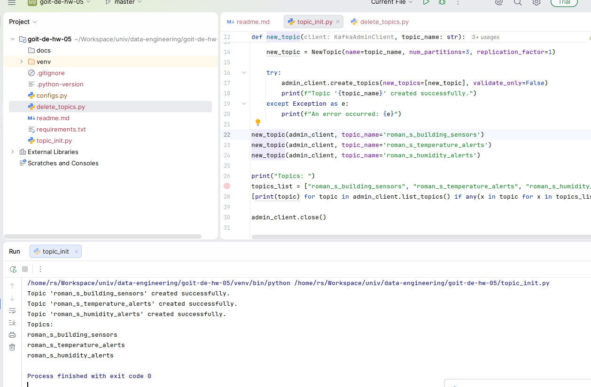
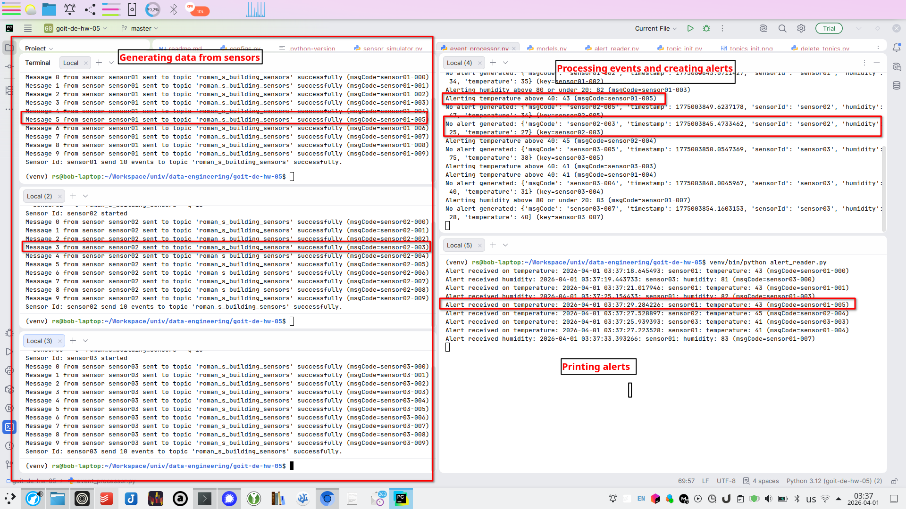

# Readme

Project simulate sensors for temperature and humidity and generate alerts for violation of border values.

# Structure

- topic_init.py - create topics
- sensor_simulator.py - create create messages for sensors and push to kafka
- event_processor.py - read messages from kafka and create alerts
- alert_reader.py - read and print alerts
- models.py - model of message
- config.py - config file

- delete_topics.py - used for deleting of topic

# Init project

```
python -m venv venv
source venv/bin/activate
venv/bin/pip install -r requirements.txt
```

# Config.py

Copy file config.py.sample and populate config of kafka

# Init topic

Run once for topic creating

```
.venv/bin/python topic_init.py
```

# Run simualtion

```bash
# simulate sensors
.venv/bin/python sensor_simulator.py -n "sensor01" -t "roman_s_building_sensors" -q 50
.venv/bin/python sensor_simulator.py -n "sensor02" -t "roman_s_building_sensors" -q 50
.venv/bin/python sensor_simulator.py -n "sensor03" -t "roman_s_building_sensors" -q 50

# process sensors events and create alerts
.venv/bin/python event_processor.py

# print alerts
.venv/bin/python alert_reader.py

```

# Samples

Creating of topics



Simulating execution

